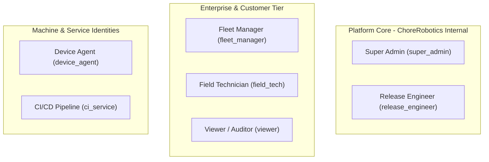
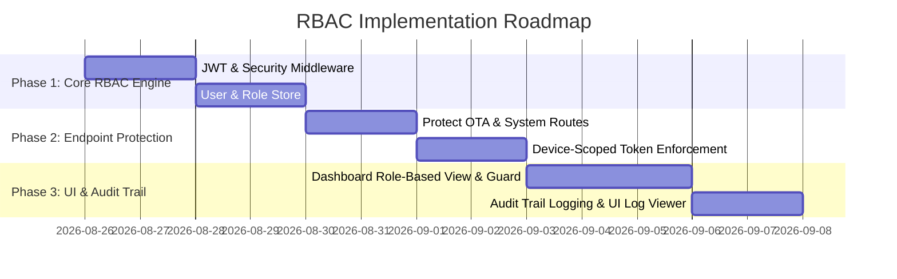

# Role-Based Access Control (RBAC) Architecture Plan
## ChoreRobotics Fleet Management & OTA Platform

---

## 1. Executive Summary & Domain Realities

In an autonomous robotics and Over-The-Air (OTA) platform, access control is a **safety-critical system**. Unlike typical SaaS applications where unauthorized access compromises data, in a physical robotics environment:
- **Flawed or malicious firmware pushes** can brick multi-thousand-dollar field units, cause electrical battery hazards, or induce unsafe motor/blade behavior in commercial or public spaces.
- **Unauthorized remote operations** (e.g., unintended movement or forced reboots during live autonomous operation) pose direct operational and safety hazards.
- **Database wipes or configuration errors** can orphan connected fleets in the field.

Therefore, our RBAC architecture must enforce **strict separation of concerns**, **least privilege**, **tenant isolation**, and **machine vs. human identity boundaries**.

---

## 2. Actor Taxonomy & Persona Definitions

We define **7 distinct Actor Personas** across 3 tiers (Platform Core, Customer/Enterprise, and Machine/Automated):



### Persona Descriptions

| Persona | Tier | Scope | Core Responsibility |
| :--- | :--- | :--- | :--- |
| **Super Admin** (`super_admin`) | Platform | Global | System administration, tenant provisioning, global overrides, security policy, system maintenance (`/api/clear`). |
| **Release Engineer** (`release_engineer`) | Platform | Global | Firmware binary signing, catalog upload (`/upload`), OTA campaign staging, canary approvals, and emergency rollback. |
| **Fleet Manager** (`fleet_manager`) | Customer | Organization | Managing assigned fleet, approving vetted firmware rollouts for company units, configuring alerts/rules, managing technicians. |
| **Field Technician** (`field_tech`) | Customer | Org / Depot | Physical service: attachment pairing/unpairing, setting `maintenance` lifecycle state, running diagnostic self-tests on specific units. |
| **Viewer / Auditor** (`viewer`) | Customer | Organization | Read-only visibility into fleet overview, telemetry, fault codes, battery metrics, and historical logs. No mutating actions. |
| **Device Agent** (`device_agent`) | Machine | Device-Only | Edge robot daemon: self-registration, heartbeat check-ins (`/api/robot/check`), update acks, telemetry/fault streaming. |
| **CI/CD Service** (`ci_service`) | Machine | Global / Scoped | Automated firmware package publishing directly from build pipelines into the catalog. |

---

## 3. Granular Permission Matrix

Permissions are structured as `resource:action` tokens:

```
┌─────────────────────────────────────────────────────────────────────────────────────────────────────────────┐
│                                       RESOURCE CATEGORIES                                                   │
│  system:*    |  firmware:*  |  deploy:*   |  device:*    |  attachment:* |  remoteops:* |  telemetry:*      │
│  campaign:*  |  faults:*    |  users:*    |  audit:*                                                        │
└─────────────────────────────────────────────────────────────────────────────────────────────────────────────┘
```

| Permission Token | Super Admin | Release Eng | Fleet Mgr | Field Tech | Viewer | Device Agent | CI Service |
| :--- | :---: | :---: | :---: | :---: | :---: | :---: | :---: |
| `system:manage` (DB clear, config) | ✅ | ❌ | ❌ | ❌ | ❌ | ❌ | ❌ |
| `users:manage` (RBAC user admin) | ✅ | ❌ | ✅ *(Org only)* | ❌ | ❌ | ❌ | ❌ |
| `firmware:upload` (`/upload`, `/upload/jetson`) | ✅ | ✅ | ❌ | ❌ | ❌ | ❌ | ✅ |
| `firmware:delete` | ✅ | ✅ | ❌ | ❌ | ❌ | ❌ | ❌ |
| `deploy:trigger` (OTA deployment) | ✅ | ✅ | ✅ *(Own fleet)* | ❌ | ❌ | ❌ | ❌ |
| `deploy:rollback` (Emergency revert) | ✅ | ✅ | ✅ *(Own fleet)* | ❌ | ❌ | ❌ | ❌ |
| `device:register` | ✅ | ❌ | ✅ | ✅ | ❌ | ✅ *(Self only)* | ❌ |
| `device:checkin` (Heartbeat / Check) | ❌ | ❌ | ❌ | ❌ | ❌ | ✅ *(Self only)* | ❌ |
| `device:ack` (Update Ack) | ❌ | ❌ | ❌ | ❌ | ❌ | ✅ *(Self only)* | ❌ |
| `device:manage` (Lifecycle, tags, edit) | ✅ | ❌ | ✅ | ✅ *(Lifecycle)* | ❌ | ❌ | ❌ |
| `attachment:pair` (Pair/unpair tools) | ✅ | ❌ | ✅ | ✅ | ❌ | ❌ | ❌ |
| `remoteops:reboot` | ✅ | ❌ | ✅ | ✅ | ❌ | ❌ | ❌ |
| `remoteops:selftest` | ✅ | ❌ | ✅ | ✅ | ❌ | ❌ | ❌ |
| `remoteops:dock` | ✅ | ❌ | ✅ | ✅ | ❌ | ❌ | ❌ |
| `telemetry:read` | ✅ | ✅ | ✅ | ✅ | ✅ | ❌ | ❌ |
| `telemetry:write` (Stream sensor data) | ❌ | ❌ | ❌ | ❌ | ❌ | ✅ *(Self only)* | ❌ |
| `faults:read` | ✅ | ✅ | ✅ | ✅ | ✅ | ❌ | ❌ |
| `faults:report` (Log DTC error) | ❌ | ❌ | ❌ | ❌ | ❌ | ✅ *(Self only)* | ❌ |
| `audit:read` | ✅ | ✅ | ✅ | ❌ | ✅ | ❌ | ❌ |

---

## 4. Authentication Architecture

### 4.1 Human Users (Dashboard Operators)
- **Mechanism:** JWT (JSON Web Token) in standard `Authorization: Bearer <token>` header or Secure HTTP-only Cookie.
- **Payload Schema:**
  ```json
  {
    "sub": "user_usr_01H9X...",
    "email": "sarah.eng@chorerobotics.com",
    "name": "Sarah Chen",
    "role": "release_engineer",
    "org_id": "org_chore_internal",
    "permissions": ["firmware:upload", "firmware:delete", "deploy:trigger", "deploy:rollback", "telemetry:read"],
    "exp": 1756156800,
    "iat": 1756113600
  }
  ```

### 4.2 Edge Devices (Robots & Jetson Units)
- **Mechanism:** Dual-layer device identity:
  1. **Provisioning Stage:** Factory Provisioning Token (`PROV_SECRET`) used during first boot (`POST /api/robot/register`).
  2. **Operational Stage:** Server issues a scoped Device Token (`device_token`) bound strictly to the `serial` and hardware `MAC/UUID`.
- **Enforcement:** A device presenting a token for `CR-2026-00001` cannot poll, check in, or ack for `CR-2026-00002`.

### 4.3 Automated CI/CD & Service Accounts
- **Mechanism:** Pre-shared High-Entropy API Keys (`cr_live_sec_...`).
- Scoped to specific actions (e.g. `firmware:upload`).

---

## 5. Tenancy & Scope Boundaries

Robots, users, and deployments belong to **Organizations**:

```
[ChoreRobotics Platform (Global)]
 ├── Tenant: ChoreRobotics Internal (Firmware, Test Fleet)
 ├── Tenant: GreenTurf Commercial Landscaping (50 Robots, 60 Mowers)
 └── Tenant: Alpine Ski Resort Operations (12 Robots, 12 Snow Plowers)
```

- **Data Filtering:** All API queries (`/api/fleet`, `/api/devices`, `/api/telemetry`) automatically scope results by `org_id` from the actor's token.
- **Global Override:** Super Admin and Release Engineers possess `org_id: "*"` to view and manage cross-tenant fleets and universal firmware catalogs.

---

## 6. Safety Guardrails & Audit Logging

### 6.1 Safety Guardrails for Critical Endpoints
1. **Destructive Operations (`POST /api/clear`):**
   - Restricted strictly to `super_admin`.
   - Requires explicit confirmation header: `X-Confirm-Destructive: "CLEAR_DATABASE"`.
2. **Fleet-Wide Deployments (`POST /deploy`):**
   - Validates that target firmware is fully scanned, non-empty, and has verified checksums.
   - Prohibits field technicians or unauthorized users from initiating mass updates.

### 6.2 Immutable Audit Trail Model
Every state-mutating request is recorded into an append-only audit log:
```json
{
  "audit_id": "aud_01H9X8Y2...",
  "timestamp": "2026-08-25T18:30:00Z",
  "actor": {
    "type": "user",
    "id": "usr_01H9X...",
    "email": "operator@greenturf.com",
    "role": "field_tech"
  },
  "action": "attachment:pair",
  "resource": {
    "type": "attachment",
    "id": "AT-LM-2026-00001",
    "target_robot": "CR-2026-00003"
  },
  "org_id": "org_greenturf_01",
  "ip_address": "192.168.1.45",
  "user_agent": "ChoreDashboard/2.0",
  "status": "SUCCESS"
}
```

---

## 7. Implementation Roadmap & Milestones



### Phase 1: Core RBAC Engine & Middleware
1. Build `auth.py` with JWT signing/verification and password hashing (bcrypt).
2. Create FastAPI dependency `get_current_user` and permission checker decorator `require_permission("deploy:trigger")`.
3. Seed default users (`admin@chorerobotics.com`, `release@chorerobotics.com`, `tech@greenturf.com`, `viewer@greenturf.com`).

### Phase 2: Endpoint Security Enforcement
1. Protect destructive routes (`/api/clear`, `/deploy`, `/upload`).
2. Add Device Token validation to `/api/robot/check`, `/api/robot/ack`, `/api/attachment/*`.
3. Support simulated demo mode (bypass flag for local dev or automated simulator).

### Phase 3: UI Role Adaptations & Audit Log
1. Topbar user profile indicator with active role badge.
2. Hide/disable unauthorized buttons (e.g. disable "Push Update to Fleet" for `viewer` and `field_tech`).
3. Audit Log tab (`#section-access`) populated with real server-side audit events.
