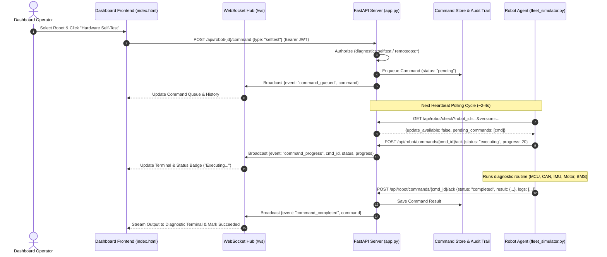

# Remote Operations & Diagnostic Command Execution Engine
## Architecture & Implementation Plan

---

### 1. Executive Summary & Objective
The **Remote Operations & Diagnostics Engine** provides secure, bi-directional command dispatching, real-time diagnostic execution, and subsystem health analysis for ChoreRobotics field units.

It replaces static browser-side mocks with:
1. **Server-side Command Queue & Broker** with RBAC authorization and audit logging.
2. **Device-side Execution Engine** in the simulator (MCU diagnostics, CAN bus ping, log dumps, safe reboots).
3. **Live Interactive Console & Terminal** in the dashboard with real-time WebSocket event streaming.

---

### 2. Architecture & Data Flow



---

### 3. Supported Command Types & Payloads

| Command Type | Key | Required RBAC Permission | Description |
| :--- | :--- | :--- | :--- |
| **Hardware Self-Test** | `selftest` | `diagnostics:selftest` | Full subsystem validation (MCU, CAN bus, IMU, motor drivers, battery BMS, vision sensors). |
| **Safe Reboot** | `reboot` | `remoteops:reboot` | Controlled OS restart, flushing filesystem buffers and verifying boot partition. |
| **Query CAN Bus** | `can_query` | `diagnostics:selftest` | Ping active CAN nodes (Base MCU `0x10`, Jetson `0x20`, Tool `0x30`), measure latency & drop rate. |
| **Fetch Crash Logs** | `fetch_logs` | `telemetry:read` | Extract kernel ring buffer (`dmesg`), ROS2 diagnostic tree, and OTA agent logs. |
| **Blink LED (Identify)**| `blink_led` | `device:manage` | Flash chassis beacon LEDs for 10 seconds for field depot identification. |
| **Return to Dock** | `dock` | `remoteops:dock` | Autonomous navigation abort and return to charging station. |
| **Partition Reset** | `partition_reset`| `system:manage` | Emergency rollback switch to pristine golden factory image partition. |

---

### 4. REST API Specifications

#### 4.1 Dispatch Command
`POST /api/robot/{robot_id}/command`
* **Headers:** `Authorization: Bearer <token>` or Session Cookie
* **Request Body:**
  ```json
  {
    "command": "selftest",
    "parameters": {
      "verbosity": "high"
    }
  }
  ```
* **Response:**
  ```json
  {
    "ok": true,
    "command_id": "cmd_98f1a23c0",
    "status": "pending",
    "robot_id": "CR-2026-00001",
    "command": "selftest",
    "created_at": "2026-09-01T15:20:00Z"
  }
  ```

#### 4.2 Robot Heartbeat Extension
`GET /api/robot/check?robot_id={id}&version={ver}`
* **Response Extension:**
  ```json
  {
    "update_available": false,
    "target_version": null,
    "pending_commands": [
      {
        "command_id": "cmd_98f1a23c0",
        "command": "selftest",
        "parameters": {}
      }
    ]
  }
  ```

#### 4.3 Command Execution Acknowledgment
`POST /api/robot/commands/{command_id}/ack`
* **Request Body:**
  ```json
  {
    "robot_id": "CR-2026-00001",
    "status": "completed",
    "progress": 100,
    "result": {
      "overall": "PASSED",
      "subsystems": {
        "mcu": {"status": "OK", "voltage_v": 3.31, "temp_c": 38.2},
        "can_bus": {"status": "OK", "nodes_discovered": 3, "bus_load_pct": 14.2},
        "imu": {"status": "OK", "drift_rate_deg_s": 0.02, "calibrated": true},
        "motor_drivers": {"status": "OK", "left_draw_a": 1.4, "right_draw_a": 1.45},
        "bms": {"status": "OK", "cell_balance_mv": 12, "soc_pct": 88}
      }
    },
    "logs": [
      "[0.000] [DIAG_INIT] Initializing hardware diagnostic routine v2.1.0",
      "[0.120] [MCU] Querying mainboard MCU at CAN 0x10... ACK received (3.3V stable)",
      "[0.340] [CAN] Scanning CAN 2.0B bus topology... 3 active nodes found",
      "[0.710] [IMU] 6-DOF IMU self-test: Accelerometer & Gyro calibrated",
      "[1.150] [MOTOR] PWM short-pulse test: Left=1.4A, Right=1.45A — within tolerance",
      "[1.420] [BMS] Battery Management System: 88% SoC, cell differential 12mV (nominal)",
      "[1.600] [DIAG_DONE] Self-test finished: All subsystems operational (PASSED)"
    ]
  }
  ```

#### 4.4 Command History
`GET /api/commands/history?robot_id={id}&limit=20`
* Returns chronological list of dispatched commands with execution status and output logs.

---

### 5. Implementation Phases

- [ ] **Phase 1: Backend Command Queue & Broker (`server/app.py`):**
  - In-memory command queue with state persistence.
  - Endpoints: `POST /api/robot/{id}/command`, `POST /api/robot/commands/{id}/ack`, `GET /api/commands/history`.
  - Integration with `/api/robot/check` polling payload.
  - WebSocket event broadcasting (`command_queued`, `command_executing`, `command_completed`).
  - RBAC verification & Audit log creation.
- [ ] **Phase 2: Simulator Diagnostic Routine Engine (`simulator/fleet_simulator.py`):**
  - Enhance `RobotAgent` check-in to process pending commands.
  - Asynchronous simulated diagnostics for all 7 commands (`selftest`, `reboot`, `can_query`, `fetch_logs`, `blink_led`, `dock`, `partition_reset`).
  - Realistic diagnostic telemetry payloads and streaming logs.
- [ ] **Phase 3: Interactive Dashboard UI & Terminal (`server/static/index.html`):**
  - Interactive Target Robot selector with live status.
  - Real Command Buttons wired to backend API.
  - Live **Engineering Diagnostic Terminal** displaying streaming logs and subsystem telemetry badges.
  - Real-time **Command History List** updating over WebSockets.
  - Telemetry policy push integration.
- [ ] **Phase 4: End-to-End Verification & Testing:**
  - Verify RBAC permission denials (e.g. viewer blocked from rebooting).
  - Verify simulator execution and WebSocket log streaming.
  - Update `features_matrix.csv`.
